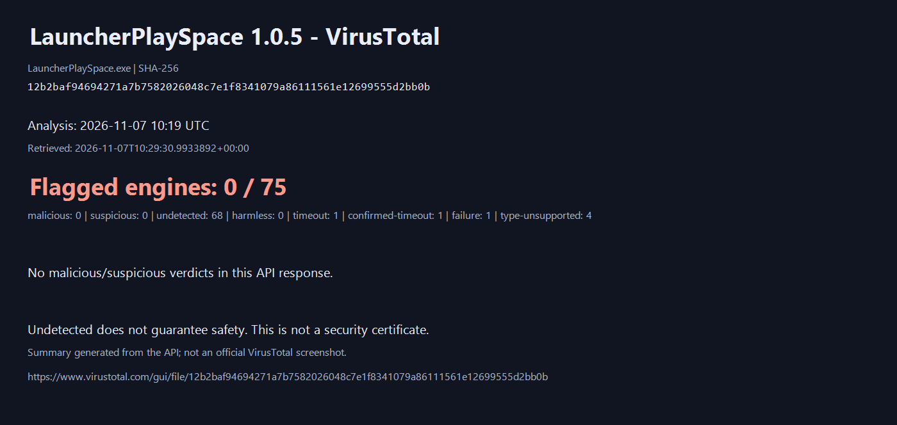

# LauncherPlaySpace 1.0.5

Авторские права (c) 2026 d3a0g  
Copyright (c) 2026 d3a0g

**Готовые сборки и обновления LauncherPlaySpace для Windows x64.**

[Скачать последнюю версию](https://github.com/d3a0g/playspace-releases/releases/latest) · [Исходный код и документация](https://github.com/d3a0g/LauncherPlaySpace) · [Поддержка](https://t.me/PlaySpaceSupport_bot)

Лаунчер объединяет библиотеку игр, статистику Steam, 500 рекомендаций, моды, сохранения и настройки производительности. Проект открыт под MIT.

## Установка

Открой последний выпуск и выбери `LauncherPlaySpace-1.0.5-Setup.exe` для установки или обновления поверх предыдущей версии. Для переносимого запуска скачай `LauncherPlaySpace-1.0.5-win-x64.zip` и распакуй архив. Файл `LauncherPlaySpace-1.0.5-source.zip` содержит исходники. Контрольные суммы доступны в `SHA256SUMS.txt`.

Настройки пользователя хранятся отдельно от приложения. Сборка пока не подписана доверенным сертификатом; политика Windows может показывать предупреждение. Дополнительные игровые компоненты устанавливаются только отдельным действием пользователя. Совместимость модов и DLSS с каждой игрой не гарантируется.

## Новый интерфейс

# LauncherPlaySpace 1.0.5

## Что изменилось

- Интерфейс: единые кнопки и поля, выравнивание навигации, поиска и сортировки, исправление масштабирования текста и переносов.
- DLSS: отдельные режимы для RTX 30 — DLSS 4.5, выбор моделей и генерация кадров FSR через OptiScaler с установкой и удалением из лаунчера.
- Карточка DLSS: видеокарта, версии найденных библиотек, условия доступности функций и собственные результаты проверки для конкретной конфигурации.
- Настройки: раздел «Что нового» с историей версий и известными ограничениями; работает без интернета.
- Моды: расширение до 69 игровых адаптеров — 36 Thunderstore, 28 ZIP и 5 Paradox.
- Библиотека: размер корневой папки EXE, устранение повторяющихся названий источника игры.
- Добавлены установщик с обновлением поверх, мастер первого запуска, перенос настроек, безопасный режим, отчёт об ошибке и проверка очистки кеша.
- Новая структура интерфейса: спокойная навигация, меню «Добавить» и «Ещё», восемь отдельных разделов настроек.
- Графика: десять отдельных параметров Unreal, адаптер настроек Cyberpunk 2077, режим без лимита FPS и просмотр изменений перед применением.
- Внешние тесты: 337 замеров, 39 сочетаний CPU/GPU и 11 игр; таблицы с поиском и фильтрами, статистика оборудования Steam, ссылки на обзоры и видео. Более выраженные кнопки разделов настроек и сглаживание текста.

## Известные ограничения

- Поддержка GPU и найденная DLL не подтверждают работу функции в конкретной игре. Версия драйвера и выбранный в игре API автоматически не проверяются.
- Генерация кадров FSR через OptiScaler экспериментальна: возможны артефакты и несовместимость. На RTX 20/30 модели DLSS 4.5 L/M могут снижать FPS сильнее прежних моделей.
- Общие результаты сообщества пока не подключены. Отметки о совместимости сохраняются только на этом компьютере и не отправляются на сервер.
- После ручного перемещения игры OptiScaler нужно переустановить для обновления пути к собственной копии DLSS.
- Локальный установщик пока без цифровой подписи; поведение защиты Windows зависит от политики клиентского ПК.
- Полная настройка графики доступна только через реализованные адаптеры; для Unity и CS2 сохраняются перечисленные поддерживаемые параметры запуска. База тестов охватывает 9 GPU и 11 игр; отсутствующие результаты не прогнозируются.

<!-- virustotal-report:start -->
## Проверка основного LauncherPlaySpace.exe 1.0.5

Анализ от 7 ноября 2026: **0 обнаружений, 68 Undetected; ещё 7 движков не дали полноценного результата**. Отсутствие обнаружений не гарантирует безопасность.

[Подробности, JSON и отдельный отчёт установщика](docs/security/README.md) · [Оригинал VirusTotal для EXE](https://www.virustotal.com/gui/file/12b2baf94694271a7b7582026048c7e1f8341079a86111561e12699555d2bb0b)

У установщика 1.0.5 отдельно зафиксированы 3 обнаружения; их причина не установлена. Результаты EXE и установщика не взаимозаменяемы.
<!-- virustotal-report:end -->
