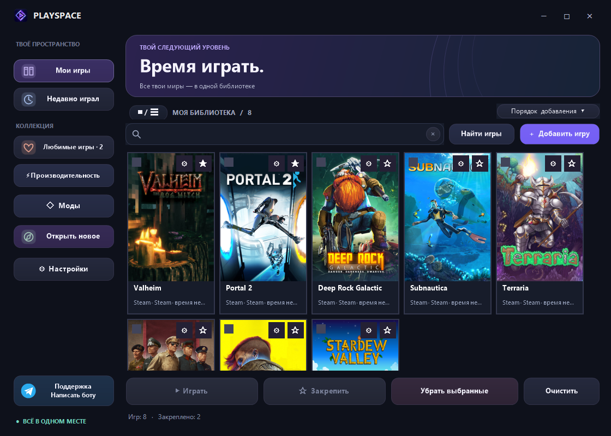
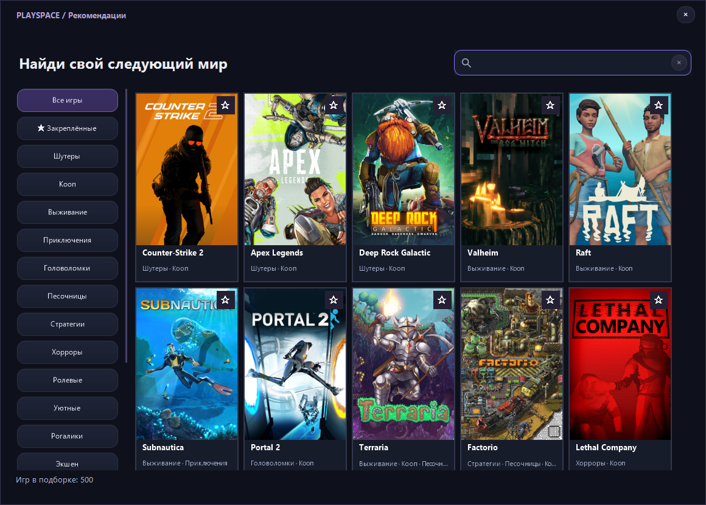
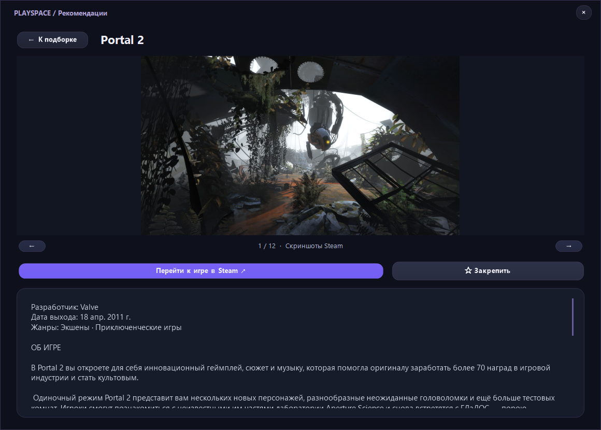
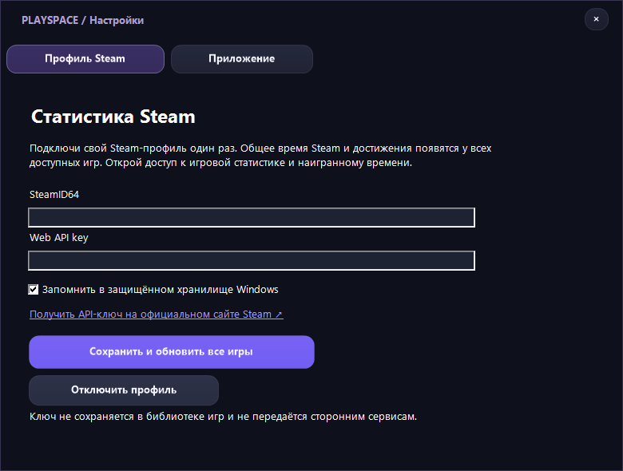
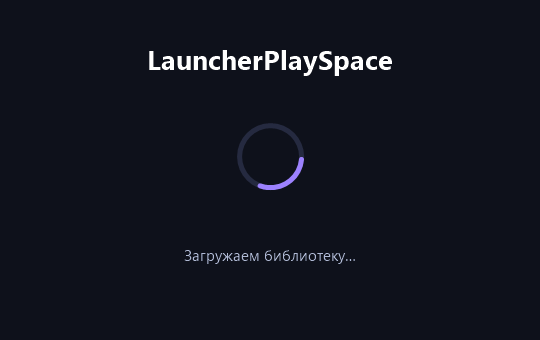
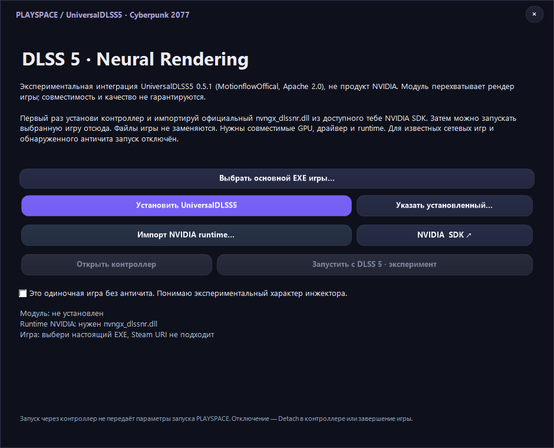

# LauncherPlaySpace

**Твоя библиотека игр, статистика Steam, моды и рекомендации — в одном Windows-приложении.**

LauncherPlaySpace объединяет установленные игры в одном интерфейсе: запускай любимые проекты, закрепляй коллекцию, смотри наигранные часы Steam и находи следующую игру в рекомендациях.

[Скачать последнюю версию](https://github.com/d3a0g/playspace-releases/releases/latest) · [Все выпуски](https://github.com/d3a0g/playspace-releases/releases) · [Поддержка в Telegram](https://t.me/PlaySpaceSupport_bot)

## Скриншоты

Реальный интерфейс версии 1.0.3 с демонстрационной библиотекой и публичными материалами Steam. Личные аккаунты и статистика на снимках не используются.

### Библиотека



### 500 рекомендаций



### Страница игры



<details>
<summary>Настройки, стартовый экран и экспериментальный модуль DLSS 5</summary>







</details>

## Что умеет LauncherPlaySpace

| Раздел | Возможности |
| --- | --- |
| Библиотека | Поиск установленных Steam- и Epic-игр, ручное добавление, поиск по коллекции, закрепление и недавние запуски. |
| Оформление | Список и сетка постеров, обложки Steam, арт выбранной игры, собственные иконки и тёмный интерфейс. |
| Статистика Steam | Общее наигранное время и процент достижений для доступных игр подключённого профиля. |
| Рекомендации | 500 игр, жанровые категории, поиск, отдельный список понравившихся игр, страницы с описанием и листаемыми скриншотами Steam. |
| Производительность | Отдельные профили игр: разрешение, режим экрана и дополнительные параметры для поддерживаемых адаптеров. |
| Моды | Встроенный каталог Thunderstore для совместимых игр, установка зависимостей и отдельное управление модами стратегий Paradox. |
| Работа в фоне | Трей, выбор действия крестика, запоминание выбора и настройка уведомлений. |
| Обновления | Проверка новой версии при запуске и в фоне, уведомления Windows и переход к загрузке выпуска. |

## Скачать и запустить

1. Открой [последний выпуск](https://github.com/d3a0g/playspace-releases/releases/latest).
2. Скачай архив **LauncherPlaySpace-<версия>-win-x64.zip**.
3. Распакуй архив в отдельную папку.
4. Запусти **LauncherPlaySpace.exe**. С версии 1.0.3 адрес обновлений встроен в EXE: `update-source.json` необязателен, приложение можно перенести на рабочий стол одним файлом.
5. Нажми «Найти игры» или добавь нужную игру вручную.

Сборка предназначена для **Windows x64**. Среда .NET включена в архив, отдельно устанавливать её не требуется. Установленные игры и необходимые игровые клиенты устанавливаются отдельно: лаунчер не содержит сами игры и не предоставляет лицензии на них.

Начиная с версии **1.0.2**, имя приложения — `LauncherPlaySpace.exe`. В выпуске 1.0.1 использовалось имя `GameLauncherGUI.exe`.

## Часы и достижения Steam

Открой **Настройки → Профиль Steam**, укажи свой **SteamID64** и личный **Steam Web API key**, затем нажми **«Сохранить и обновить все игры»**.

- Часы берутся из общего времени Steam, включая время до установки LauncherPlaySpace.
- Локальные сессии не прибавляются к общим часам Steam.
- Достижения загружаются сразу для всей доступной Steam-библиотеки.
- Игровая статистика и наигранное время должны быть доступны через Steam API. Закрытый профиль и ограничения API могут скрывать часть данных.
- Если сеть недоступна, сохраняются последние успешно загруженные часы.
- При включённом запоминании API-ключ хранится в защищённом хранилище Windows, а не в файле библиотеки игр.

Для игр вне Steam доступен локальный счётчик времени, пока лаунчер работает, в том числе в трее.

## Рекомендации

В каталоге **500 игр**: шутеры, выживание, кооп, головоломки, хорроры, стратегии, ролевые, приключения, песочницы, уютные игры и другие категории.

Нажми карточку, чтобы открыть страницу игры: сверху находятся скриншоты со стрелками переключения, ниже — кнопки **«Перейти к игре в Steam»** и **«Закрепить»**, затем полное прокручиваемое описание магазина. Закреплённые рекомендации сохраняются отдельно от установленных игр.

Это подборка для знакомства с играми. Наличие карточки не означает, что игра установлена, приобретена или проверена на твоём ПК. Покупка и установка выполняются в официальном магазине.

## Производительность

Профиль сохраняется отдельно для каждой игры. Возможности зависят от адаптера:

- **Unity**: разрешение и режим окна через параметры запуска.
- **Counter-Strike 2**: разрешение, режим экрана и ограничение FPS.
- **MECCHA CHAMELEON, Palworld и GTFO**: параметры запуска Unreal и поддерживаемые настройки существующего `GameUserSettings.ini`; перед изменением создаётся резервная копия.
- **Другие игры**: доступные возможности показываются в интерфейсе; неподдерживаемые настройки не применяются автоматически.

Настройки не гарантируют заданный FPS: результат зависит от игры, оборудования и её текущей версии. Профили не заменяют драйверы и официальные настройки видеокарты.

## Моды

Для совместимых игр доступен каталог Thunderstore: **R.E.P.O., Lethal Company, Valheim, Risk of Rain 2, ROUNDS, ULTRAKILL, Inscryption, Content Warning, PEAK, Dyson Sphere Program, MECCHA CHAMELEON, Palworld и GTFO**. Для установки загрузчиков и отдельных пакетов используются игровые адаптеры; нестандартные форматы могут не поддерживаться.

Для **Hearts of Iron IV, Europa Universalis IV, Stellaris, Crusader Kings III и Imperator: Rome** доступны импорт ZIP с `descriptor.mod`, включение и отключение модов и порядок загрузки. Моды Workshop скачивает клиент Steam; после загрузки их можно зарегистрировать в лаунчере. Профиль применяется при запуске игры через LauncherPlaySpace.

Совместимость конкретного мода с игрой, версией и DLC зависит от автора мода. Универсальная поддержка всех игр и всех модов не заявляется.

## Обновления

Приложение проверяет канал при запуске и раз в час. При доступной новой версии показывает предложение обновиться и отправляет уведомление Windows. В трее приложение продолжает проверку без принудительного открытия главного окна.

Уведомления можно отключить через **ПКМ по значку в трее** или **Настройки → Приложение**. Кнопка обновления открывает скачивание в браузере; автоматическая замена запущенного EXE не выполняется.

Для обновления:

1. Полностью заверши лаунчер через «Выход».
2. Скачай и распакуй новый архив.
3. Запусти EXE из новой папки. Старый EXE после переименования больше не нужен.

Библиотека, локальная статистика и настройки остаются в **`%LOCALAPPDATA%\GameLauncherPRO`**. Переименование EXE не меняет эту папку. Не удаляй её, если хочешь сохранить свою коллекцию.

Постоянный канал: https://github.com/d3a0g/playspace-releases/releases/latest/download/latest.json

## Крестик и трей

При нажатии на крестик можно выбрать **«Свернуть в трей»** или **«Выйти полностью»** и отметить **«Запомнить выбор»**. Вернуть вопрос или изменить действие можно в **Настройки → Приложение**. Двойной щелчок по значку в трее возвращает окно.

## Поддержать разработку

Если LauncherPlaySpace тебе полезен, можно добровольно поддержать его развитие: улучшение интерфейса, новые игровые адаптеры, исправления и обновления.

**Перевод на карту Альфа-Банка:**

```text
2200 1545 5587 3610
```

Поддержка добровольная. Перевод не обязателен для скачивания и использования опубликованных сборок и не является покупкой игр или обещанием конкретных сроков новых функций.

## Обратная связь

Поддержка и предложения: **[@PlaySpaceSupport_bot в Telegram](https://t.me/PlaySpaceSupport_bot)**.

Если что-то не работает, укажи версию лаунчера, название игры, действие перед ошибкой и текст ошибки. Можно приложить скриншот. Не отправляй пароли, API-ключи и коды подтверждения.

## Открытый исходный код

С версии **1.0.3** исходники LauncherPlaySpace, тесты и обработчик поддержки опубликованы под [MIT](LICENSE). Можно изучать, изменять и распространять оригинальный код с сохранением лицензии. Игры, изображения магазинов, моды и сторонние компоненты сохраняют собственные лицензии: [THIRD_PARTY_NOTICES.md](THIRD_PARTY_NOTICES.md).

### Собрать самостоятельно

Нужны Windows x64 и **.NET SDK 10**. Скачай исходники через Code → Download ZIP или клонируй репозиторий.

```powershell
 dotnet build GameLauncherGUI/GameLauncherGUI.csproj -c Release
 dotnet run --project GameLauncherGUI/GameLauncherGUI.csproj -c Release
```

Проверки логики и интерфейса запускаются отдельной консольной программой:

```powershell
 dotnet run --project GameLauncherGUI.Tests/GameLauncherGUI.Tests.csproj -c Release -- --ui
```

Сборка переносимого EXE со встроенной средой .NET:

```powershell
 dotnet publish GameLauncherGUI/GameLauncherGUI.csproj -c Release -r win-x64 --self-contained true -p:PublishSingleFile=true -p:DebugType=None -p:DebugSymbols=false -o artifacts/publish
```

Для воспроизводимого архива с лицензиями и каналом обновлений используй `tools/Publish-Release.ps1`; публикация в GitHub выполняется отдельным `tools/Publish-ToGitHub.ps1`.

### Структура и документация

- [GameLauncherGUI](GameLauncherGUI) — клиент Windows Forms.
- [GameLauncherGUI.Tests](GameLauncherGUI.Tests) — проверки, включая временные игровые каталоги и UI.
- [PlaySpace.SupportBot](PlaySpace.SupportBot/README.md) — отдельный серверный обработчик Telegram, пример приватной конфигурации.
- [Моды](GameLauncherGUI/MODS.md), [производительность](GameLauncherGUI/PERFORMANCE.md), [Steam и библиотека](GameLauncherGUI/LIBRARY.md), [обновления](GameLauncherGUI/UPDATES.md).
- [Экспериментальный Universal DLSS 5](GameLauncherGUI/UNIVERSAL-DLSS5.md) — требования, ограничения и проверка компонентов. Модуль не гарантирует совместимость с каждой игрой; NVIDIA runtime не включён в поставку.
- [Изменения 1.0.3](GameLauncherGUI/LOCAL-CHANGES.md), [участие в разработке](CONTRIBUTING.md), [сообщить об уязвимости](SECURITY.md).

Токены, пользовательская библиотека, переписки поддержки и локальные настройки не входят в исходники и готовую сборку. Для своего бота создай отдельную приватную конфигурацию по инструкции в его каталоге.

LauncherPlaySpace — независимый проект. Названия игр, Steam, Epic Games и других сервисов принадлежат их правообладателям.